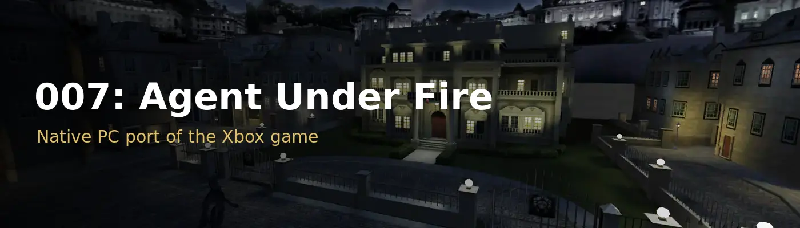

  

  
  
  

  <a href="#getting-started"><b>Getting started</b></a> &nbsp;·&nbsp;
  <a href="#building"><b>Building</b></a> &nbsp;·&nbsp;
  <a href="https://discord.gg/PQjkKsdtc"><b>Discord</b></a>

  

**The 2002 Xbox Bond shooter, running natively on PC.** This is not an emulator. The game's own x86 code is statically
recompiled with the [Xbox XBE Recomp](https://github.com/TGP482/XboxXBE-Recomp) toolkit into a Windows program, with a
new renderer, sound and input underneath: true widescreen, frame rates above the console's 30, sharper graphics, mouse
and keyboard, modern pads, and settings inside the game's own menus.

> [!NOTE]
> This project does not include any game assets. You need your own copy of the Xbox game to build and play.

## Table of contents

- [Xbox vs. PC](#xbox-vs-pc)
- [Features](#features)
- [PC Settings](#pc-settings)
- [Cheats](#cheats)
- [Graphics settings](#graphics-settings)
- [Controls](#controls)
- [Requirements](#requirements)
- [Getting started](#getting-started)
- [FAQ](#faq)
- [Known issues](#known-issues)
- [Roadmap](#roadmap)
- [Community and support](#community-and-support)
- [Building](#building)
- [Credits and legal](#credits-and-legal)

## Xbox vs. PC
[(Back to top)](#table-of-contents)

  
   
  <i>All extras off vs. render scale 200%, MSAA 4x and sharpening 50%, at 1920x1080 (brightened here so the night scene shows).</i>

The Xbox drew Agent Under Fire at 640x480, at 4:3, and on foot at 30 frames a second. The port draws it at your
screen's resolution and shape, as often as your screen allows, with anti-aliasing and sharpening layered on top of the
game's own picture.

## Features
[(Back to top)](#table-of-contents)

| | |
|---|---|
| **Widescreen** | True proportions on any screen wider than 4:3, 16:10, 3:2 and 21:9 included: the 3D view widened, the menus and HUD kept in a 4:3 centre. A 4:3 screen keeps the console's own picture. |
| **High frame rates** | On foot the game follows your frame rate cap (60 by default, up to 240 or unlimited) with its speed tied to real time. Driving missions and mounted guns run 60 game steps a second instead of PAL's 50, at the same game speed, and above a cap of 60 draw the frames in between. |
| **Mouse and keyboard** | The mouse looks directly on foot and aims mounted guns directly, zooms a scope with the wheel and works the menus with a pointer. Menus and hints show your keys. |
| **PC Settings in the game** | A row on the main menu and a RECOMP tab on the pause screen, on foot and driving. Everything is also in the F1 window and `settings.toml`. |
| **Cheats** | Invincible and Unlimited Ammo for the missions on foot, switched on or off in PC Settings. |
| **Sharper graphics** | Render scale up to 200%, MSAA, FXAA or SMAA, sharpening, anisotropic filtering, enhanced textures and sharp text and HUD. |
| **Both discs, three languages** | The PAL disc in English, French and German, and the USA disc. |
| **Achievements** | Each mission, the medals, and every gold and platinum. |
| **Quality of life** | Skip intro movies, field of view 50 to 150%, auto-aim on or off, the hit flash on or off, F12 screenshots at full resolution. |

  
   
  <i>Driving, with the HUD kept in its centre.</i>

  
   
  <i>On the gun in mission 2, aimed with the mouse.</i>

## PC Settings
[(Back to top)](#table-of-contents)

  
   
  <i>The RECOMP tab of the pause screen, on foot and driving. The main menu has a PC Settings row too.</i>

| Page | Settings |
|---|---|
| **Graphics** | Render scale, MSAA, edge smoothing (FXAA, SMAA), smooth alpha edges, texture filtering, sharpening, scaling filter |
| **Picture** | Sharp text and HUD, enhanced textures, frame counter |
| **Display** | Display mode, vertical sync, frame rate cap, aspect ratio, renderer (Direct3D 12 or 11), high frame rate, field of view |
| **Controls** | Mouse sensitivity, invert mouse, auto-aim |
| **Game** | Language, skip intro movies, pause in background, hit flash |
| **Cheats** | Invincible, Unlimited Ammo (on foot) |

**F1** opens the settings window over the game, with the same settings and more: key and button bindings and the
controller options. Everything is saved in `settings.toml` beside the game.

  
   
  <i>Menus show your keys while you play on keyboard and mouse.</i>

## Cheats
[(Back to top)](#table-of-contents)

On the Cheats page of PC Settings, for the missions on foot:

- **Invincible:** Bond takes no damage. The screen still flashes when he is hit.
- **Unlimited Ammo:** endless spare ammo for every weapon, the Golden Gun included. Magazines still reload.

More are planned: see the [Roadmap](#roadmap).

## Graphics settings
[(Back to top)](#table-of-contents)

Shots of one spot at 1920x1080, taken one after another and brightened here so the dark scene shows; the close-ups are
enlarged twice.

  
   
  <i>Edges: all off, MSAA 4x, FXAA and render scale 200%.</i>

- **MSAA** smooths the edges of the 3D scene and keeps textures sharp. The more samples, the slower.
- **Edge smoothing** works on the finished frame, HUD included: FXAA softens it a little, SMAA keeps it crisper.

  
   
  <i>Edge smoothing off vs. SMAA.</i>

- **Render scale** draws the picture larger than the screen: the smoothest fine detail, and the slowest.
- **Sharpening** makes the picture crisper. Around 50% is a good start.

  
   
  <i>Sharpening off, 50% and 100%.</i>

- **Smooth alpha edges** soften fences, leaves and other cut-out textures, with MSAA on.
- **Texture filtering** keeps roads and walls sharp into the distance.
- **Scaling filter** chooses how the frame reaches the screen when render scale is not 100%: bilinear, or sharp.
- **Enhanced textures** double the 3D scene's textures in the background. They use more video memory and can cause a
  brief hitch as new ones appear.

## Controls
[(Back to top)](#table-of-contents)

| Control | On foot | Driving | On a mounted gun |
| --- | --- | --- | --- |
| Move / steer | W S forward and back, A D strafe | W gas, S brake, A D steer | |
| Look | Mouse | | Mouse |
| Fire | Left button | Left button | Left button |
| Manual aim / zoom | Right button, wheel zooms a scope | | Right button |
| Jump | Space | | |
| Crouch | C, Left Ctrl | | |
| Action, reload, open | E, R | | R reload |
| Use gadget | G | Right button, E | |
| Alt. fire | F, Middle button | | |
| Weapon | Wheel, Q, 1 next, 3 before | Wheel, Q, Z, 1 2 | |
| Gadget | 2 next, arrows left and right | 3 4 | |
| Handbrake | | Space | |
| Camera / look back | Tab, V center view | C camera, V look back | |
| Pause | Esc, P | Esc, P | Esc, P |
| Menus | Enter, left button select; Backspace, right button back; wheel, arrows move | the same | |
| Screenshot | F12 | F12 | F12 |
| Settings window | F1 | F1 | F1 |

Keys can be changed in the F1 window. Pads play with the game's own Xbox layout.

## Requirements
[(Back to top)](#table-of-contents)

- **Your own copy of the game**, an `.iso` image of your disc or a folder with its files:
  - the European (PAL) Xbox release, title id 4541000D: `default.xbe` SHA-1 `3dbed4eb51701a53676e0ace4cdea1752dc04697`,
    `bond_eng.xbe` `66aace3859a5ca9a992f2d1845c2b5f5265fd9d6`, `bond_fre.xbe` `87b2d3c8b7b40916fe29b03490c84c4f690a4c12`,
    `bond_ger.xbe` `88d06191f3ba940394f258f138f0aa37f1ced1dd`, `DRIVING.XBE` `6b58e61ee8ce9aa2a1a357affe188af874cf05f4`;
  - or the USA Xbox release: `default.xbe` SHA-1 `dff80de4f889ef5ee70ac748a0391f2ed220d0e9`, with `bond.xbe` and
    `Driving.xbe`.
- **Windows 10 or 11, 64 bit**, and a graphics card with Direct3D 12 or Direct3D 11.
- **An internet connection** for the launcher to fetch the package for your disc.

## Getting started
[(Back to top)](#table-of-contents)

The launcher sets the game up on your PC from your own disc: no Visual Studio, no Git and no command line, nothing
installed in Windows and no admin rights needed. A release holds the runtime and a compiler, and none of the game's
code.

1. Download `AgentUnderFireLauncher.exe` from the [latest release](https://github.com/hk21x/007-agentunderfire-recomp/releases/latest).
2. Put it in a folder of its own and run it. Windows may warn about an unrecognised app: choose **More info**, then
   **Run anyway**.
3. Choose your disc image or folder and press **Get the game ready**. The launcher downloads the package for your disc
   and compiles the game's code from your disc; how long that takes depends on your PC and connection.
4. Press **Play**. When a new version is out, the launcher offers **Update**; your saves and settings are kept.

| File in a release | What it is |
|---|---|
| `AgentUnderFireLauncher.exe` | **The only file to download by hand.** It fetches the rest itself. |
| `AgentUnderFire-PAL-package.zip` | Runtime and compiler for the PAL disc, no game code. The launcher fetches it for that disc; don't unzip it by hand. |
| `AgentUnderFire-USA-package.zip` | The same for the USA disc. |
| `*-package.zip.json` | The size and SHA-256 the launcher checks each download against. You can ignore them. |

Settings live in `settings.toml`, logs in `logs` and screenshots in `screenshots`, all beside the game
(`AgentUnderFire\play` with the launcher).

## FAQ
[(Back to top)](#table-of-contents)

<b>Is this an emulator?</b>

 
No. The game's x86 code is translated ahead of time into C++ and built as a Windows program. The Xbox's graphics,
sound and input are rebuilt for the PC underneath it. That is what makes true widescreen, high frame rates on foot and
settings inside its menus possible.

<b>Why a recompilation?</b>

 
Agent Under Fire never came out on PC. Recompiling the Xbox game makes it a present-day Windows program:
<ul>
<li><b>The whole game is ours to change.</b> A feature is a change in source and in our own renderer: the mouse aiming
mounted guns, the menus' pointer and PC Settings in the game's own pause screen were built that way.</li>
<li><b>One runtime for several games.</b> Widescreen, anti-aliasing, controllers, achievements and the settings window
come from the toolkit this port shares with other Xbox ports, and a fix made for one reaches the others.</li>
<li><b>64 bit and Direct3D 12</b>, with no old graphics or input layers to keep working on new versions of Windows.</li>
</ul>

<b>Why do I need my own copy of the game?</b>

 
The game belongs to its rights holders. This project shares only its own work: the game's code and assets are made
from your disc when the launcher gets the game ready.

<b>How do I get the most frames above 60?</b>

 
In driving missions and on mounted guns, set a Frame Rate Cap above 60 and turn <b>Vertical Sync off</b>. With it on,
the extra frames are limited by your screen and can settle near 60. On foot the cap and your screen decide as usual.

<b>The launcher's build failed.</b>

 
Send <code>AgentUnderFire\launcher.log</code>. After a network problem, press Build again and it carries on where it
stopped. If it stops while unpacking the Windows SDK, the folder path is too long: move the launcher to a short folder
such as <code>C:\Games\AgentUnderFire</code>.

<b>Something is wrong. What should I send?</b>

 
<code>AgentUnderFire\play\logs\auf.log</code> (its first lines list your settings and GPU) and any <code>.dmp</code>
file beside the game. Please include them when you report a problem on
<a href="https://github.com/hk21x/007-agentunderfire-recomp/issues">GitHub</a> or the
<a href="https://discord.gg/PQjkKsdtc">Discord server</a>.

## Known issues
[(Back to top)](#table-of-contents)

- **The mouse can stall for about a second every few seconds** on some PCs
  ([#12](https://github.com/hk21x/007-agentunderfire-recomp/issues/12)). A fix is in the works.
- **Saves lost after a driving mission** have been reported and are being looked into; a log from such a session helps.
- **Not yet covered by testing:** every later mission played to its end, and a multiplayer match.

## Roadmap
[(Back to top)](#table-of-contents)

- **More cheats** ([#5](https://github.com/hk21x/007-agentunderfire-recomp/issues/5)): all weapons, the car's health and
  rockets, everything unlocked with platinum medals, one-hit kills and the multiplayer unlockables.
- **The developer console** the game kept from its engine, and easier gadget controls.
- **The mouse stall fix** in the next update.

## Community and support
[(Back to top)](#table-of-contents)

Join the [Discord server](https://discord.gg/PQjkKsdtc) for help getting the game running, to report problems, and to
talk about the port with other players.

## Building
[(Back to top)](#table-of-contents)

For developers; players should use the launcher above.

1. Clone with submodules: `git clone --recurse-submodules https://github.com/hk21x/007-agentunderfire-recomp`.
2. Extract your disc into `assets` (PAL: `default.xbe`, `bond_eng.xbe`, `bond_fre.xbe`, `bond_ger.xbe`, `DRIVING.XBE`,
   `assets\`, `driving.dat\`; USA: `default.xbe`, `bond.xbe`, `Driving.xbe` and the folders).
3. Install Visual Studio 2022 with C++ desktop development and run `build.bat`. The exes are in `out\build\release`.
   Run `AgentUnderFire.exe`; it starts the others itself.

PAL is five programs (the launcher and movies, the game in each of three languages, and the driving levels), USA three,
and the build recompiles those of the disc in `assets`. On Windows each program's code is a DLL. `release-package.bat`,
after `build.bat`, makes that disc's package for a release: one per disc, each from a checkout holding that disc. A `v*`
tag only makes a draft release with the launcher: attach both zips and their `.json` files, then publish it by hand.

## Credits and legal
[(Back to top)](#table-of-contents)

- [Xbox XBE Recomp](https://github.com/TGP482/XboxXBE-Recomp), the recompiler and runtime this is built on.
- [XenonRecomp](https://github.com/hedge-dev/XenonRecomp) for the overridable function layout and instruction hooks.
- [Zydis](https://github.com/zyantific/zydis) for decoding x86 instructions, [toml++](https://github.com/marzer/tomlplusplus)
  for the configs, [Dear ImGui](https://github.com/ocornut/imgui) for the settings overlay and
  [SDL](https://github.com/libsdl-org/SDL) for the window, input and controllers.

*007: Agent Under Fire* © its respective rights holders. Developed and published by Electronic Arts. James Bond and 007
are trademarks of their owners. This is an unofficial fan project, not affiliated with or endorsed by them. No game code
or assets are distributed: they are made from your own copy of the game.

**AI disclosure:** much of this project's code, tooling and documentation was written with AI assistance (Anthropic's
Claude), directed, reviewed and playtested by the author.
